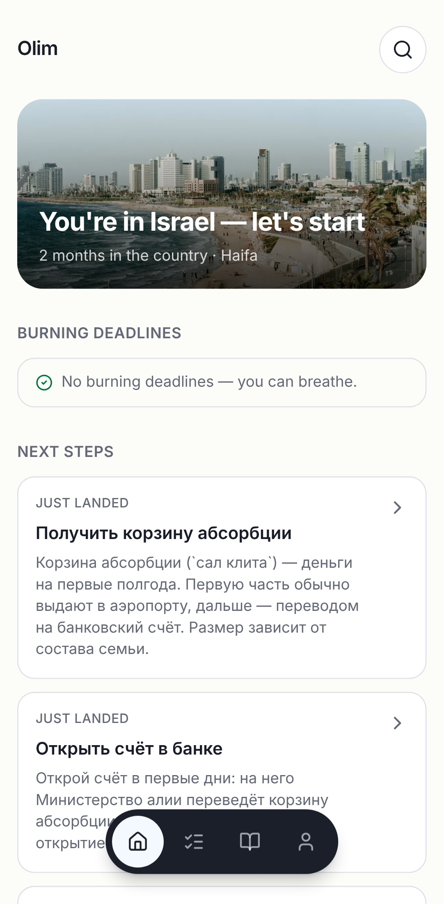
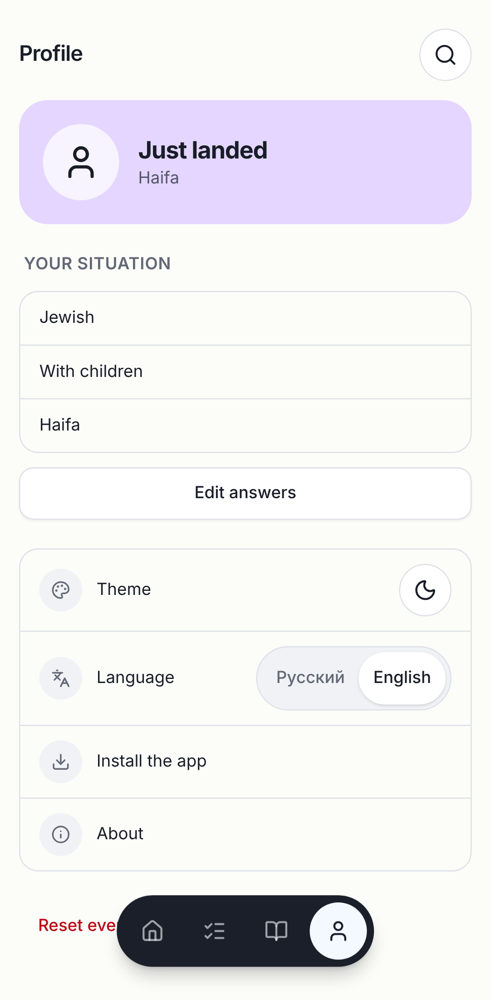
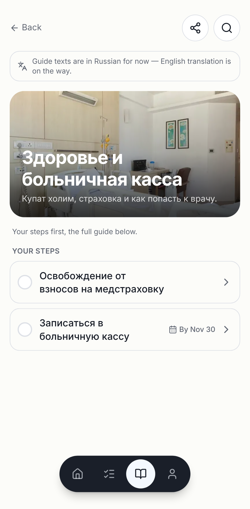
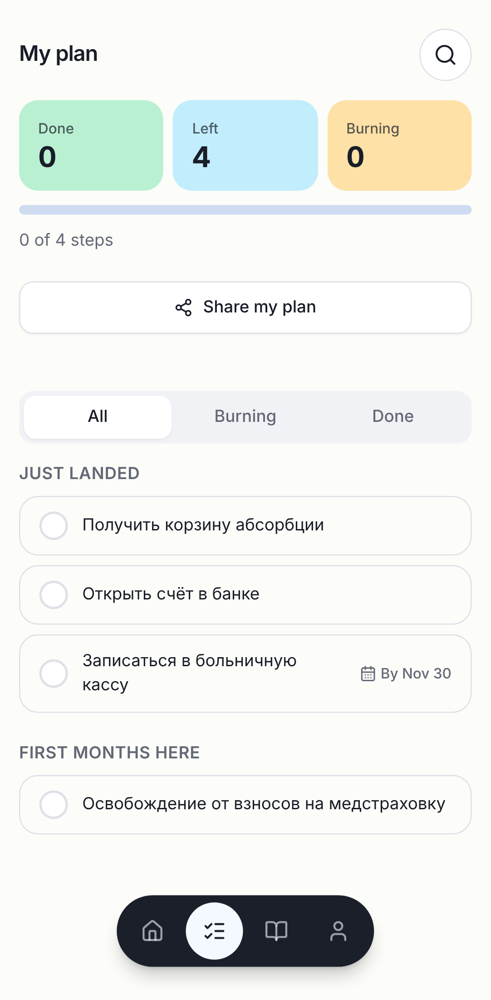

# English UI (post-MVP)

Goal: ship the English interface. The `messages/en.json` dictionary had been
complete since Phase 1, but `i18n/request.ts` hard-wired `ru`, so English was
unreachable. Scope is the **interface**: guide content (sections/steps in the DB)
is still Russian-only and is the next step (see Deferred).

## Done

- **Locale routing** — every page moved under `app/[locale]/` (`ru` | `en`),
  `localePrefix: "as-needed"`: Russian keeps every existing URL (`/plan`,
  `/guides/...`), English lives under `/en/...`. `proxy.ts` runs next-intl's
  middleware; the layout validates the locale, calls `setRequestLocale`, and
  prerenders both locales. ISR/static parity with `main` verified route by route
  (pages, static OG images, `llms.txt`, `manifest` all stay static).
- **Language choice is explicit only.** No `Accept-Language` detection (many
  Russian-speaking olim use English-language phones). The Profile language row
  (was a "RU · Soon" placeholder) is now a RU/EN switch of real links; the choice is
  saved in the `NEXT_LOCALE` cookie and `proxy.ts` sends unprefixed visits to it
  (`/` → `/en`). An explicit `/ru/...` link records "Russian" (works without JS).
- **Bug caught before shipping:** with next-intl's built-in cookie, the service
  worker precaching `/en/...` on install rewrote the cookie to `en` and flipped
  every Russian user to English. Fixed by disabling next-intl's cookie/detection
  and writing the cookie only on an explicit choice; documented in AGENTS.md
  Known traps.
- **Two more of the same class, found in review:** (1) Next's Link prefetch of the
  switcher's `/ru/profile` hit the proxy, which wrote `NEXT_LOCALE=ru` — an English
  reader was reset to Russian just by opening Profile; (2) with `NEXT_LOCALE=en`,
  the SW precache of `/`, `/plan`, `/offline`… was redirected to `/en/...`, storing
  English HTML under the Russian URLs. `proxy.ts` now applies the cookie redirect
  and cookie write to page navigations only (`Sec-Fetch-Dest: document`; RSC and
  prefetch requests excluded), and the switcher links don't prefetch. Both cases
  have e2e regressions in `tests/e2e/i18n.spec.ts` (verified failing without the fix).
- **Links** — locale-aware `Link` / `usePathname` (`i18n/navigation.tsx`), a thin
  wrapper over `next/link`. next-intl's `createNavigation` was tried first and cost
  +4–16 KB gz JS per route; the wrapper brings that back to +3–12 KB (most of the
  remainder is the switcher/notes + the larger message set). Hand-built URLs (search
  `?q=` sync, guide sheet URL sync, share links) use `useLocalePath`.
- **SEO** — `lib/seo/i18n.ts`: translated routes (home, plan, onboarding, about)
  are self-canonical per locale with hreflang + `x-default`; `og:locale` per locale;
  sitemap lists them in both locales with alternates (incl. `x-default`). Guide
  routes (`/en/guides/...`) are `noindex, follow` with no canonical/hreflang — an
  English shell around Russian text is neither a translation nor a clean duplicate,
  and Google advises against cross-language canonicals. Russian guides are untouched.
  OG images are served at `/ru/...` directly (no 307), and the old unprefixed image
  URLs still answer 200.
  `revalidate` also purges the `[locale]` layout.
- **Honest mixed-language UX** — English guide pages show "Guide texts are in
  Russian for now — English translation is on the way."; guide lists carry
  `lang="ru"` for screen readers.
- **Offline in English** — the SW precaches the app shell + offline page in both
  locales (`PRECACHE_DOCUMENT_ROUTES`); an `/en/...` navigation falls back to
  `/en/offline` first; the inline last-resort page is bilingual.

## Deferred (and why)

- **Guide content translation** (sections, steps, docs, tips in Supabase). Needs a
  content-schema change (`*_en` fields or a translations table), an additive
  migration on the shared DB (neighbor-backup ritual), translation of ~111 steps in
  the private `olim-content` repo, and an editorial pass — bureaucratic text where a
  wrong translation can harm someone. Out of scope for "translate the interface".
- **Search in English** — keyword search uses a Russian tsvector; the AI answer
  already replies in the question's language but cites Russian steps.
- **Emails** (magic link, reminders, unsubscribe page) and `llms.txt` stay Russian.
- **OG image `alt`** is a static Russian export (needs `generateImageMetadata`).

## Known debts

- Home "next steps"/section tiles in English show Russian step titles without the
  "Russian only" note (it is on the guides index/section pages).
- On a slow network an English user's offline/timeout fallback for the unprefixed
  start URL (`/`) is the Russian precached copy (the SW can't know the cookie).

## Verification

```
pnpm lint          # Checked 243 files. No fixes applied.
pnpm typecheck     # clean
pnpm test          # 53 files, 340 tests passed
pnpm build         # ok; /[locale] routes SSG for ru + en, ISR 1h unchanged
pnpm e2e           # 96 passed, 16 skipped (account specs need local Supabase — same as main)
                   # tests/e2e/i18n.spec.ts: 100/100 with --repeat-each=5
pnpm lighthouse    # all 9 URLs pass (incl. new /en, /en/plan); a11y 1.0, SEO 1.0
```

Lighthouse medians (local, mobile, simulate; noisy container), this branch vs `main`:

| URL | perf (branch) | perf (main) | JS gz (branch / main) |
|---|---|---|---|
| `/` | 0.85 | 0.85 | 232 / 229 KB |
| `/plan` | 0.88 | 0.88 | 232 / 229 KB |
| `/onboarding` | 0.96 | 0.95 | 219 / 218 KB |
| `/guides` | 0.92 | 0.92 | 210 / 207 KB |
| `/guides/healthcare` | 0.91 | 0.90 | 225 / 227 KB |
| step page | 0.87 | 0.87 | 225 / 220 KB |
| `/en` | 0.89 | — | 232 KB |
| `/en/plan` | 0.91 | — | 232 KB |

Manual curl checks (prod build): `/` with `Accept-Language: en` → 200 Russian;
`/` + cookie `en` → 307 `/en`; `/ru/plan` → 307 `/plan` + cookie `ru`; `/en` sets no
cookie; `/de/plan` → 404; canonical/hreflang/og:locale as described above.

## Screenshots

| Home (EN) | Profile switcher | Guide with RU note | Plan (EN) |
|---|---|---|---|
|  |  |  |  |
